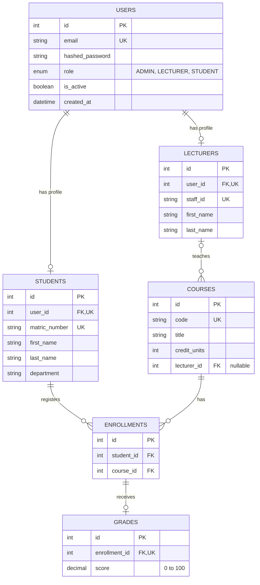

# Database schema

Key constraints: a student can register for a course only once (`UNIQUE(student_id, course_id)`), an enrollment has at most one grade, and scores are limited to 0-100 by a database check constraint.